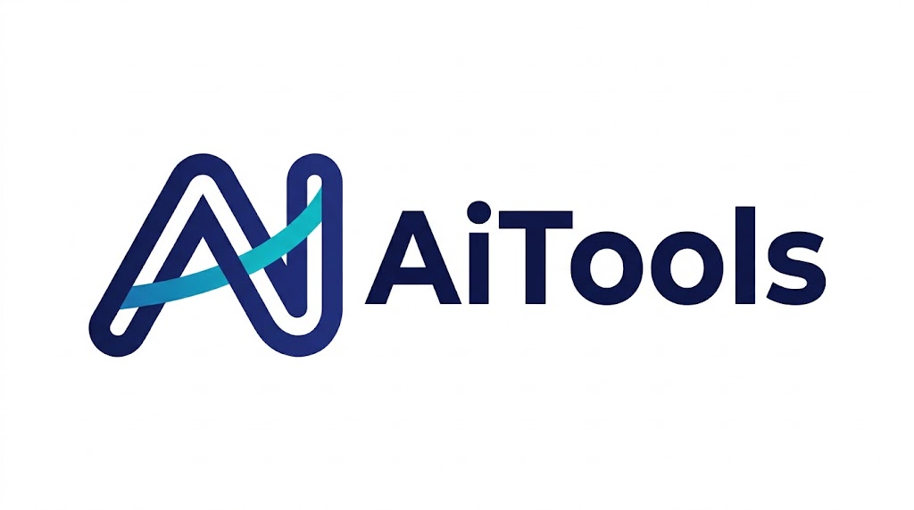
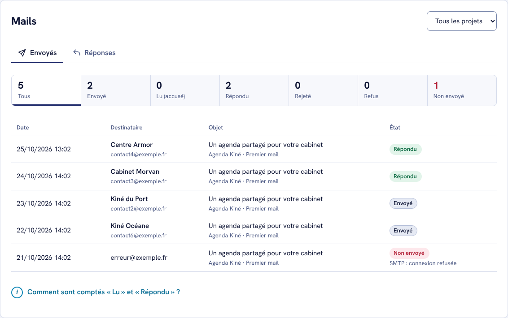

  

<h1 align="center">iaboss</h1>

  <strong>Ton IA écrit tes mails de prospection. Toi, tu les relis et tu les signes.</strong> 
  Trouve tes premiers clients sans y passer tes soirées, avec Claude, ChatGPT ou Gemini.

  <a href="https://iaboss.fr"><strong>Essayer gratuitement</strong></a> ·
  <a href="https://iaboss.fr/fonctionnement">Comment ça marche</a> ·
  <a href="https://iaboss.fr/tarifs">Tarifs</a>

---

## Tu as construit un produit. Il te manque des clients.

Coder, tu sais faire. Trouver les entreprises qui en ont besoin, leur écrire un mail qui donne envie de répondre, relancer, suivre qui a dit quoi… c'est un deuxième métier, et il mange ton temps.

**iaboss le fait à ta place, avec ta propre IA.** Il lit ton dépôt Git pour comprendre ce que tu proposes, cherche les entreprises qui pourraient en avoir besoin, écrit un mail personnalisé pour chacune et suit les réponses. Toi, tu relis et tu valides. Rien ne part sans ton accord.

  

## En 4 étapes

1. **Relie ton IA.** Claude, ChatGPT ou Gemini, avec ta propre clé ou ton abonnement.
2. **Ajoute ton dépôt Git.** GitHub ou ton propre serveur : ton IA lit ton projet, sans rien y modifier.
3. **Valide la cible.** Elle te dit à qui elle pense parler. Tu corriges, puis tu valides.
4. **Lance la recherche.** Elle trouve les contacts et écrit les mails. Tu relis et tu confirmes l'envoi.

## Ce que ton IA fait pour toi

| | |
|---|---|
| 🔎 **Elle cherche des entreprises** | Uniquement des adresses professionnelles publiées au grand jour, avec la page d'où vient chacune. |
| ✍️ **Elle écrit chaque mail** | Un mail court par entreprise, avec une accroche tirée de son site. Relu par l'IA avant de partir. |
| 🔁 **Elle relance une fois** | Pas de réponse ? Une seule relance, dans la même conversation, aux heures de bureau. |
| 📬 **Elle suit les réponses** | Qui a répondu, qui attend, qui reste à contacter, sans ouvrir ta boîte. |
| 📣 **Elle écrit tes contenus** | Posts LinkedIn, posts Instagram avec visuel, newsletters, vidéos de promotion. |
| 🧾 **Elle prépare tes devis** | Devis, acompte, facture et avoir aux couleurs de ton projet, relus par l'IA. |

## Du premier mail à la facture

Quand un prospect dit oui, tu continues au même endroit :

**Prospecter** → **Suivre** → **Facturer** → **Encaisser** → **Déclarer**

La cible, les contacts et les mails ; les réponses et les rendez-vous ; le devis, la facture et l'avoir ; ce qui reste à encaisser ; le montant à saisir sur ta déclaration URSSAF.

## Tu gardes la main

- **Rien ne part sans ton accord.** Chaque lot de mails attend ta confirmation, chaque post attend ton clic.
- **Les mails partent de ta propre boîte**, avec un lien de désinscription. Jamais plus de 300 mails par 24 heures.
- **Tes données restent cloisonnées.** Personne d'autre ne voit tes prospects ni tes brouillons.
- **Tes secrets sont chiffrés** en base, jamais réaffichés.
- **Connexion en un clic** avec Google ou Apple, sans mot de passe à retenir.

## Tarifs

Gratuit pour commencer, sans carte bancaire et sans limite de durée. Ton accès à l'IA est facturé directement par son fournisseur (Anthropic, OpenAI ou Google) : c'est ce qui permet des prix bas.

| Offre | Prix / mois | Projets | Prospects | Mails / semaine | Tâches IA / semaine |
|---|---|---|---|---|---|
| **Gratuit** | 0 € | 2 | 100 | 50 | 4 |
| **Démarrage** | 9 € | 3 | 500 | 250 | 12 |
| **Croissance** | 19 € | 8 | 1 500 | 700 | 35 |
| **Business** | 29 € | 15 | 5 000 | 1 400 | 90 |
| **Intensif** | 75 € | 40 | 15 000 | 2 100 | 220 |

À l'année, **2 mois offerts**. Prix TTC, résiliable à tout moment. Le détail des fonctionnalités par offre est sur [iaboss.fr/tarifs](https://iaboss.fr/tarifs).

## Questions fréquentes

**Faut-il une carte bancaire ?** Non. Le plan Gratuit s'ouvre sans carte et sans limite de durée.

**Dois-je fournir mon propre accès à une IA ?** Oui : Claude, ChatGPT ou Gemini, au choix.

**Mon projet doit-il avoir un dépôt Git ?** Oui. Ton IA le lit pour comprendre ce que tu proposes, sans rien y modifier.

**Les mails partent-ils tout seuls ?** Non. Chaque lot attend ta confirmation, et tu n'écris qu'à des professionnels.

**Que se passe-t-il quand j'atteins un plafond ?** La nouvelle action est refusée, rien n'est supprimé. Les compteurs repartent chaque lundi à minuit (heure de Paris).

---

  <a href="https://iaboss.fr"><strong>Crée ton compte gratuitement →</strong></a>

  Développeurs : installation, architecture et sécurité dans <a href="docs/TECHNIQUE.md">docs/TECHNIQUE.md</a>.
  API et serveur MCP : <a href="docs/API.md">docs/API.md</a>, <a href="docs/MCP.md">docs/MCP.md</a>.

